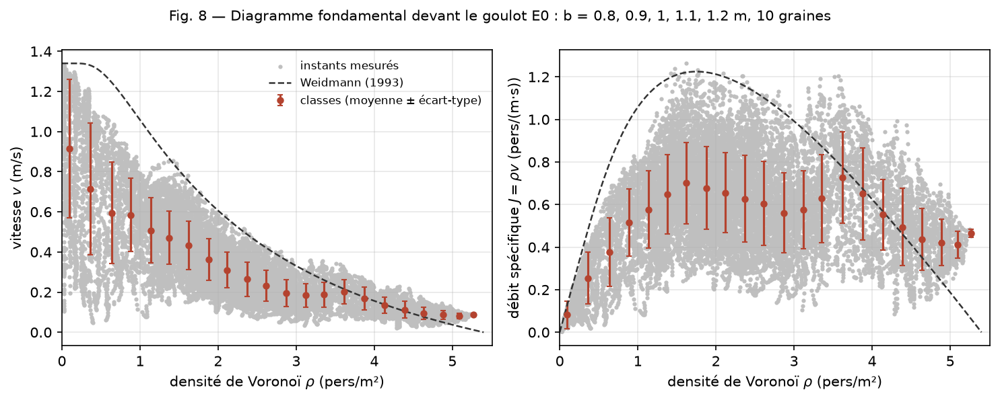

# Diagramme fondamental devant le goulot E0 (M8, #124)

E0 compare le **débit global** du goulot à Seyfried et al. (2009) ([`goulot.yaml`](../experiments/goulot.yaml), journal, entrée E0). La problématique porte, elle, sur le **diagramme fondamental**, la relation entre la densité d'une foule et sa vitesse ou son débit (spec § 3). `viscocrowd diagramme-goulot` mesure cette relation devant le goulot sec et la confronte à Weidmann (1993).

## Commande

```bash
viscocrowd diagramme-goulot experiments/goulot.yaml \
  --sortie data/m8/diagramme.json --figure data/m8
```

Par défaut : les cinq largeurs du protocole (0,8 à 1,2 m), dix graines à partir de celle du YAML, la zone `x ∈ [6,0 ; 7,8] m`, `y ∈ [1,5 ; 3,5] m`, un instant toutes les 0,1 s à partir de 3 s, et des classes de 0,25 pers/m². Les 50 simulations prennent environ 5 min en séquence. Les mesures ci-dessous ont été lancées une largeur par processus, ce qui donne exactement les mêmes séries.

## Mesure

- **Points.** À chaque instant retenu : densité et vitesse de Voronoï dans la zone (Steffen et Seyfried 2010, `mesures_voronoi`), avec le débit spécifique `J = ρ v`. La vitesse d'un agent est son déplacement réalisé sur le pas précédent, c'est-à-dire la vitesse du modèle relue après la projection.
- **Classes.** `observables.diagramme.classer` donne la moyenne et l'écart-type de chaque classe de densité. Les points d'une même simulation sont corrélés : **l'écart-type décrit la dispersion des états, pas l'incertitude sur la moyenne**.
- **Trois choix, à discuter avant toute conclusion :**
  1. **Zone** : l'entonnoir où #101 a mesuré le biais de densité. Les cellules sont bornées par les murs de la salle, mur percé compris. C'est exact sur trois côtés et approché près de l'ouverture, où les agents déjà engagés dans le goulot ne comptent pas.
  2. **Début à 3 s** : à t = 0, la foule est au repos à 3,3 pers/m², puis le bloc démarre d'un seul tenant. En commençant à 1 s, 396 points formaient une branche à fort débit (ρ > 3,3 pers/m², J > 1,3 pers/(m·s)), tous entre 1,0 et 1,9 s. À partir de 3 s, il n'en reste aucun.
  3. **Pas de mesure de 0,1 s** : des instants plus serrés ne seraient pas plus indépendants.
  4. **Pas de borne de fin** : la mesure court jusqu'à la sortie du dernier agent. Or E0 n'a pas de phase stationnaire : 60 agents partent à 3,3 pers/m² et la salle se vide sans palier. Sur la graine 1 à b = 1,2 m, la densité de la zone vaut 4,6 pers/m² à 3 s, 2,3 à 11 s, 1,0 à 22 s et 0,02 à 27 s. Chaque point est donc un instant d'une file qui se vide, et non un état d'équilibre comme ceux que mesurent Weidmann ou Seyfried. Pour chaque largeur, 99 à 100 % des points à ρ < 1 pers/m² tombent dans le dernier tiers de leur série (634 sur 4 288 à b = 0,8 m, 500 sur 2 513 à 1,2 m) : **les classes sous 1 pers/m² décrivent la fin de la vidange**, quand les derniers agents suivent ceux déjà engagés dans le goulot.

## Résultats du 13 novembre 2026

Commit `259c5f8`, sans modification locale, Windows 11, Python 3.12.10, NumPy 2.5.4, SciPy 1.18.1. `goulot.yaml` de référence (60 agents, T = 0,35 s). Graines 1 à 10, 50 écoulements, **15 641 points**. Bilans par largeur et figure dans [`mesures/diagramme-e0-2026-11-13/`](mesures/diagramme-e0-2026-11-13/).



Toutes largeurs confondues, en classes de 0,5 pers/m² :

| ρ moyen (pers/m²) | Points | v (m/s) | v Weidmann | J (pers/(m·s)) | J Weidmann |
|---|---|---|---|---|---|
| 0,21 | 1601 | 0,83 ± 0,35 | 1,34 | 0,15 ± 0,13 | 0,28 |
| 0,77 | 1000 | 0,59 ± 0,22 | 1,18 | 0,45 ± 0,17 | 0,91 |
| 1,29 | 2140 | 0,49 ± 0,14 | 0,91 | 0,62 ± 0,19 | 1,17 |
| 1,75 | 2627 | 0,40 ± 0,12 | 0,70 | 0,69 ± 0,19 | 1,23 |
| 2,24 | 2659 | 0,29 ± 0,09 | 0,53 | 0,64 ± 0,20 | 1,18 |
| 2,74 | 1886 | 0,21 ± 0,07 | 0,39 | 0,58 ± 0,19 | 1,07 |
| 3,23 | 1233 | 0,19 ± 0,06 | 0,29 | 0,60 ± 0,20 | 0,92 |
| 3,75 | 763 | 0,18 ± 0,06 | 0,19 | 0,69 ± 0,22 | 0,73 |
| 4,27 | 817 | 0,12 ± 0,04 | 0,12 | 0,52 ± 0,18 | 0,51 |
| 4,75 | 765 | 0,09 ± 0,03 | 0,06 | 0,43 ± 0,13 | 0,30 |
| 5,09 | 150 | 0,08 ± 0,01 | 0,03 | 0,41 ± 0,06 | 0,15 |

Vitesse moyenne de la classe autour de 1 pers/m², par largeur : 0,36 m/s (b = 0,8 m), 0,54 (0,9), 0,64 (1,0), 0,65 (1,1) et 0,83 m/s (1,2).

## Ce que ces mesures disent, et ce qu'elles ne disent pas

- **Sous 3 pers/m², la vitesse vaut 50 à 62 % de celle de Weidmann**. Sous 1 pers/m², ce sont les derniers agents de la vidange, pas une foule clairsemée (choix 4). Le débit plafonne vers 0,7 pers/(m·s), contre 1,23. Les deux se rejoignent vers 4 pers/m², et au-delà de 4,5 pers/m² la vitesse dépasse celle de Weidmann. Le modèle n'a pas de densité d'arrêt : seul l'empilement compact des disques, 7,2 pers/m², l'arrête. Weidmann, lui, s'arrête à 5,4 pers/m².
- **À densité égale, la vitesse dépend de la largeur du goulot**, du simple au double entre 0,8 et 1,2 m. Devant un goulot, l'écoulement est réglé par la capacité du goulot, et non par la seule densité locale. Une partie de cet écart tient aussi à la vidange : un goulot large vide la salle plus vite, si bien qu'à 1 pers/m² on ne compare pas le même moment de l'évacuation.
- **Ce n'est donc pas une comparaison dans le domaine de Weidmann.** Ses relations valent « sans contrainte extérieure », pour une marche unidirectionnelle (p. 64). L'entonnoir devant un goulot n'en relève pas. Ces chiffres ne valident ni ne réfutent le modèle face à Weidmann. Ils décrivent la file d'attente devant un goulot.
- **Pour comparer dans le domaine de Weidmann**, il faudrait une mesure en écoulement libre unidirectionnel, par exemple dans le couloir, à plusieurs densités imposées. C'est la prochaine étape proposée dans #124, avec la mesure devant la porte de la piscine.
