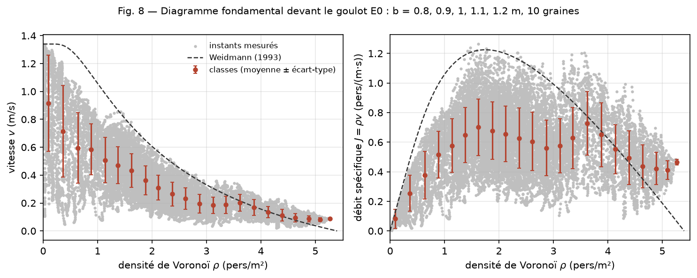

# Diagramme fondamental devant le goulot E0 (M8, #124)

E0 compare le **débit global** du goulot à Seyfried et al. (2009) ([`goulot.yaml`](../experiments/goulot.yaml), journal, entrée E0). La problématique porte, elle, sur le **diagramme fondamental**, la relation entre la densité d'une foule et sa vitesse ou son débit (spec § 3). `viscocrowd diagramme-goulot` mesure cette relation devant le goulot sec et la confronte à Weidmann (1993).

## Commande

```bash
viscocrowd diagramme-goulot experiments/goulot.yaml \
  --sortie data/m8/diagramme.json --figure data/m8
```

Par défaut : les cinq largeurs du protocole (0,8 à 1,2 m), dix graines à partir de celle du YAML, la zone `x ∈ [6,0 ; 7,8] m`, `y ∈ [1,5 ; 3,5] m`, un instant toutes les 0,1 s à partir de 3 s, et des classes de 0,25 pers/m². Les 50 simulations prennent environ 5 min en séquence. Les mesures ci-dessous ont été lancées une largeur par processus, ce qui donne exactement les mêmes séries.

## Mesure

- **Points.** À chaque instant retenu : densité et vitesse de Voronoï dans la zone (Steffen et Seyfried 2010, `mesures_voronoi`), avec le débit spécifique `J = ρ v`. La vitesse d'un agent est son déplacement réalisé sur le pas précédent, c'est-à-dire la vitesse du modèle relue après la projection.
- **Classes.** `observables.diagramme.classer` donne la moyenne et l'écart-type de chaque classe de densité. Les points d'une même simulation sont corrélés : **l'écart-type décrit la dispersion des états, pas l'incertitude sur la moyenne**.
- **Trois choix, à discuter avant toute conclusion :**
  1. **Zone** : l'entonnoir où #101 a mesuré le biais de densité. Les cellules sont bornées par les murs de la salle, mur percé compris. C'est exact sur trois côtés et approché près de l'ouverture, où les agents déjà engagés dans le goulot ne comptent pas.
  2. **Début à 3 s** : à t = 0, la foule est au repos à 3,3 pers/m², puis le bloc démarre d'un seul tenant. En commençant à 1 s, 396 points formaient une branche à fort débit (ρ > 3,3 pers/m², J > 1,3 pers/(m·s)), tous entre 1,0 et 1,9 s. À partir de 3 s, il n'en reste aucun.
  3. **Pas de mesure de 0,1 s** : des instants plus serrés ne seraient pas plus indépendants.
  4. **Pas de borne de fin** : la mesure court jusqu'à la sortie du dernier agent. Or E0 n'a pas de phase stationnaire : 60 agents partent à 3,3 pers/m² et la salle se vide sans palier. Sur la graine 1 à b = 1,2 m, la densité de la zone vaut 4,6 pers/m² à 3 s, 2,3 à 11 s, 1,0 à 22 s et 0,02 à 27 s. Chaque point est donc un instant d'une file qui se vide, et non un état d'équilibre comme ceux que mesurent Weidmann ou Seyfried. Pour chaque largeur, 99 à 100 % des points à ρ < 1 pers/m² tombent dans le dernier tiers de leur série (634 sur 4 288 à b = 0,8 m, 500 sur 2 513 à 1,2 m) : **les classes sous 1 pers/m² décrivent la fin de la vidange**, quand les derniers agents suivent ceux déjà engagés dans le goulot.

## Résultats du 13 novembre 2026

Commit `259c5f8`, sans modification locale, Windows 11, Python 3.12.10, NumPy 2.5.4, SciPy 1.18.1. `goulot.yaml` de référence (60 agents, T = 0,35 s). Graines 1 à 10, 50 écoulements, **15 641 points**. Bilans par largeur et figure dans [`mesures/diagramme-e0-2026-11-13/`](mesures/diagramme-e0-2026-11-13/).



Toutes largeurs confondues, en classes de 0,5 pers/m² :

| ρ moyen (pers/m²) | Points | v (m/s) | v Weidmann | J (pers/(m·s)) | J Weidmann |
|---|---|---|---|---|---|
| 0,21 | 1601 | 0,83 ± 0,35 | 1,34 | 0,15 ± 0,13 | 0,28 |
| 0,77 | 1000 | 0,59 ± 0,22 | 1,18 | 0,45 ± 0,17 | 0,91 |
| 1,29 | 2140 | 0,49 ± 0,14 | 0,91 | 0,62 ± 0,19 | 1,17 |
| 1,75 | 2627 | 0,40 ± 0,12 | 0,70 | 0,69 ± 0,19 | 1,23 |
| 2,24 | 2659 | 0,29 ± 0,09 | 0,53 | 0,64 ± 0,20 | 1,18 |
| 2,74 | 1886 | 0,21 ± 0,07 | 0,39 | 0,58 ± 0,19 | 1,07 |
| 3,23 | 1233 | 0,19 ± 0,06 | 0,29 | 0,60 ± 0,20 | 0,92 |
| 3,75 | 763 | 0,18 ± 0,06 | 0,19 | 0,69 ± 0,22 | 0,73 |
| 4,27 | 817 | 0,12 ± 0,04 | 0,12 | 0,52 ± 0,18 | 0,51 |
| 4,75 | 765 | 0,09 ± 0,03 | 0,06 | 0,43 ± 0,13 | 0,30 |
| 5,09 | 150 | 0,08 ± 0,01 | 0,03 | 0,41 ± 0,06 | 0,15 |

Vitesse moyenne de la classe autour de 1 pers/m², par largeur : 0,36 m/s (b = 0,8 m), 0,54 (0,9), 0,64 (1,0), 0,65 (1,1) et 0,83 m/s (1,2).

## Ce que ces mesures disent, et ce qu'elles ne disent pas

- **Sous 3 pers/m², la vitesse vaut 50 à 62 % de celle de Weidmann**. Sous 1 pers/m², ce sont les derniers agents de la vidange, pas une foule clairsemée (choix 4). Le débit plafonne vers 0,7 pers/(m·s), contre 1,23. Les deux se rejoignent vers 4 pers/m², et au-delà de 4,5 pers/m² la vitesse dépasse celle de Weidmann. Le modèle n'a pas de densité d'arrêt : seul l'empilement compact des disques, 7,2 pers/m², l'arrête. Weidmann, lui, s'arrête à 5,4 pers/m².
- **À densité égale, la vitesse dépend de la largeur du goulot**, du simple au double entre 0,8 et 1,2 m. Devant un goulot, l'écoulement est réglé par la capacité du goulot, et non par la seule densité locale. Une partie de cet écart tient aussi à la vidange : un goulot large vide la salle plus vite, si bien qu'à 1 pers/m² on ne compare pas le même moment de l'évacuation.
- **Ce n'est donc pas une comparaison dans le domaine de Weidmann.** Ses relations valent « sans contrainte extérieure », pour une marche unidirectionnelle (p. 64). L'entonnoir devant un goulot n'en relève pas. Ces chiffres ne valident ni ne réfutent le modèle face à Weidmann. Ils décrivent la file d'attente devant un goulot.
- **Pour comparer dans le domaine de Weidmann**, il faudrait une mesure en écoulement libre unidirectionnel, par exemple dans le couloir, à plusieurs densités imposées. C'est la prochaine étape proposée dans #124, avec la mesure devant la porte de la piscine.

---

# Devant la porte de la piscine : mouillé contre sec (#124)

La question de la problématique : le carrelage mouillé déplace-t-il le diagramme fondamental devant la porte ? `viscocrowd diagramme-piscine` mesure la densité et la vitesse de Voronoï devant la porte, pour la piscine mouillée (E2) et pour le témoin entièrement sec (E1), appariés graine par graine (`scenarios/diagramme_piscine.py`).

```bash
viscocrowd diagramme-piscine experiments/piscine.yaml --graines 1 2 3 4 5 6 7 8 9 10 \
  --sortie data/m8/piscine.json
viscocrowd diagramme-piscine experiments/piscine.yaml --graines 1 2 3 4 5 6 7 8 9 10 \
  --fixer largeur_porte=0.8 --sortie data/m8/piscine-0.8.json
```

## Méthode

- **Salle de Voronoï.** La plage n'est pas convexe, puisque le bassin y fait un trou. On prend donc le rectangle de la plage qui va de 10 m avant le mur de la porte jusqu'à ce mur, sur toute la largeur (`x ∈ [38 ; 48] m`). Il ne contient ni le bassin ni les points de réintroduction : la commande refuse tout recul qui les atteindrait, et tout obstacle dans la salle. Les nageurs, les agents sur un bord, les agents déjà sortis et les plagistes plus loin de la porte n'ont pas de cellule. Les cellules sont exactes le long des murs, mais **approchées devant l'ouverture** : les agents engagés dans le couloir de la porte (`48 < x < 49 m`) sont encore actifs mais n'ont pas de cellule, et la ligne `x = 48 m` borne les cellules de ceux qui attendent devant. C'est la même réserve que pour E0 à l'ouverture du goulot, et la zone, à 0,2 m du mur, est dans la région concernée. Elles sont aussi approchées sur le bord gauche du rectangle, à 8 m de la zone.
- **Zone.** 1,8 m sur 2 m devant la porte, centrée sur son axe, à 0,2 m du mur, comme celle de E0.
- **Instants.** Toute l'évacuation, un instant toutes les 0,1 s. Comme pour E0, il n'y a pas de phase stationnaire : la file se forme puis se vide.

## Résultats du 14 novembre 2026

Code du commit `0ff523d` (les bilans indiquent `modifications_locales: true`, car ce module a été mesuré juste avant d'être commité, sans autre changement ; leur empreinte des sources, `9670c067…`, est bien celle de `0ff523d`, ce qui rend la phrase vérifiable), sur la branche de #126, à jour avec `dev` après #128. macOS arm64, Python 3.14.4. Graines 1 à 10, 20 évacuations par largeur. Bilans dans [`mesures/diagramme-piscine-2026-11-14/`](mesures/diagramme-piscine-2026-11-14/).

**Porte de 1,2 m (référence), 8 339 points.** Pas de file : la porte n'est jamais saturée (E4, #128).

| ρ (pers/m²) | Points sec / mouillé | v sec (m/s) | v mouillé (m/s) | v Weidmann |
|---|---|---|---|---|
| 0,12 | 2615 / 2574 | 1,97 ± 0,11 | 1,97 ± 0,11 | 1,34 |
| 0,38 | 1264 / 1292 | 1,60 ± 0,27 | 1,61 ± 0,26 | 1,33 |
| 0,62 | 248 / 256 | 1,28 ± 0,20 | 1,28 ± 0,20 | 1,25 |
| 0,88 | 40 / 38 | 1,12 ± 0,17 | 1,13 ± 0,17 | 1,13 |

**Porte de 0,8 m (saturée), 12 189 points.** Une branche congestionnée apparaît.

| ρ (pers/m²) | Points sec / mouillé | v sec (m/s) | v mouillé (m/s) | v Weidmann |
|---|---|---|---|---|
| 0,12 | 1066 / 1092 | 1,68 ± 0,45 | 1,67 ± 0,46 | 1,34 |
| 0,38 | 302 / 281 | 0,92 ± 0,44 | 0,96 ± 0,43 | 1,33 |
| 0,62 | 628 / 776 | 0,69 ± 0,19 | 0,67 ± 0,17 | 1,25 |
| 0,88 | 2973 / 2863 | 0,58 ± 0,07 | 0,58 ± 0,08 | 1,13 |
| 1,12 | 757 / 707 | 0,54 ± 0,10 | 0,54 ± 0,10 | 0,99 |
| 1,38 | 264 / 276 | 0,50 ± 0,07 | 0,50 ± 0,07 | 0,87 |
| 1,62 | 88 / 92 | 0,46 ± 0,09 | 0,45 ± 0,09 | 0,75 |
| 1,88 | 14 / 10 | 0,39 ± 0,03 | 0,40 ± 0,03 | 0,65 |

(Écart-type = dispersion des états, pas incertitude. Classes de 0,25 pers/m², centre de classe indiqué.)

## Ce que ces mesures disent, et ce qu'elles ne disent pas

- **Le carrelage mouillé ne déplace pas le diagramme devant la porte**, ni à 1,2 m ni à 0,8 m : dans chaque classe, les vitesses du sec et du mouillé diffèrent de quelques centièmes de m/s, bien moins que leur dispersion. C'est cohérent avec E1/E2 et E4 (§ 6 du rapport) : la bande mouillée est à 17 m de la porte, et les agents l'ont quittée bien avant la file.
- **À 1,2 m, la zone ne voit presque que de la marche libre.** Vers 0,1 pers/m², la vitesse vaut celle souhaitée en panique (2,0 m/s), au-dessus de Weidmann, qui décrit une marche ordinaire ; elle tombe à 1,6 m/s vers 0,4 pers/m². Ces classes peu denses ne sont pas une foule clairsemée devant la porte : ce sont des cellules de plusieurs m², d'agents isolés dans une salle de 10 × 20,5 m, qui débordent sur la zone. C'est correct pour une densité de Voronoï, mais à lire comme tel.
- **À 0,8 m, la file freine fort.** Entre 0,6 et 1,9 pers/m², la vitesse vaut 45 à 60 % de celle de Weidmann. Ce n'est pas une comparaison dans son domaine (foule contrainte par une porte saturée, en panique), mais c'est la branche congestionnée que la problématique demande de comparer entre sec et mouillé.
- **La densité reste modérée** (sous 2 pers/m²) parce que la zone couvre aussi les côtés de la porte, où la foule est plus clairsemée qu'en son centre. Une zone plus étroite, sur l'axe, donnerait des densités plus fortes : c'est l'un des choix à discuter.
- À l'adhérence de référence, mouiller la plage jusqu'à la porte ne change rien non plus (#137 : Δ t100 = 0,09 ± 0,41 s). La configuration où l'hypothèse inertielle apparaît est une plage **très glissante** jusqu'à la porte saturée : elle est mesurée ci-dessous.

## Plage très glissante jusqu'à la porte saturée (14 novembre, refait le 17 novembre)

#137 trouve que la porte de 0,8 m perd 19 % de son débit quand la plage est mouillée jusqu'à elle avec `a_max = 1 m/s²` (0,1 g), et un témoin (#140) montre que cet effet disparaît quand seule la bande de 3 m est glissante. Le diagramme mesure ce qui se passe dans la file. Première mesure le 14 novembre (commit `9520606`, [bilan](mesures/diagramme-piscine-2026-11-14/porte-0.8-mouille-porte-a1.json)), **avant** la règle de déblocage de #131 ; les chiffres ci-dessous sont ceux du 17 novembre, avec le code actuel, qui produit aussi la figure 9 du rapport : commit `4479cd9`, sans modification locale, macOS arm64, graines 1 à 10, 20 évacuations, 244 s. Bilan : [`bilan.json`](mesures/diagramme-piscine-glissante-2026-11-17/bilan.json). Shaleena retrouve les mêmes chiffres sous Windows, à un instant près (revue de #142).

```bash
viscocrowd diagramme-piscine experiments/piscine.yaml --graines 1 2 3 4 5 6 7 8 9 10 \
  --fixer largeur_porte=0.8 largeur_mouillee=20 adherence_mouille=1 --sortie data/m8/piscine-0.8-a1.json
```

Le témoin sec est le même qu'à la section précédente, au bit près.

| ρ (pers/m²) | Points sec / mouillé | v sec (m/s) | v mouillé (m/s) | v Weidmann |
|---|---|---|---|---|
| 0,12 | 1066 / 1002 | 1,68 ± 0,45 | 1,53 ± 0,55 | 1,34 |
| 0,38 | 302 / 295 | 0,92 ± 0,44 | 0,93 ± 0,53 | 1,33 |
| 0,62 | 628 / 300 | 0,69 ± 0,19 | 0,68 ± 0,40 | 1,25 |
| 0,88 | 2973 / 298 | 0,58 ± 0,07 | 0,56 ± 0,28 | 1,13 |
| 1,12 | 757 / 419 | 0,54 ± 0,10 | 0,43 ± 0,17 | 0,99 |
| 1,38 | 264 / 1004 | 0,50 ± 0,07 | 0,38 ± 0,11 | 0,87 |
| 1,62 | 88 / 1121 | 0,46 ± 0,09 | 0,35 ± 0,09 | 0,75 |
| 1,88 | 14 / 747 | 0,39 ± 0,03 | 0,32 ± 0,08 | 0,65 |
| 2,12 à 3,88 | 0 / 2224 | — | de 0,29 à 0,11 | de 0,56 à 0,17 |

- **La file devient bien plus dense.** Sur le sec, la zone ne dépasse jamais 2 pers/m², et la classe la plus peuplée est 0,88 pers/m². Sur la plage glissante, 30 % des points du mouillé (2 224 sur 7 410) dépassent 2 pers/m², jusqu'à 3,9 pers/m².
- **À densité égale, la file glissante va 20 à 24 % moins vite** entre 1,1 et 1,7 pers/m², où chaque sol compte des centaines d'instants (0,43 contre 0,54 m/s à 1,12 pers/m², 0,35 contre 0,46 m/s à 1,62 pers/m²). Vers 1,9 pers/m², l'écart de 18 % ne repose que sur 14 instants secs. En dessous de 1 pers/m², les vitesses moyennes se confondent, mais la dispersion du mouillé est plus grande, 2 à 4 fois entre 0,6 et 0,9 pers/m².
- **Le diagramme se déplace donc**, et c'est la première mesure directe de l'hypothèse inertielle devant la porte. Deux lectures, compatibles, restent des interprétations : une vitesse plus faible à densité égale est ce qu'on attend de relances écrêtées dans le va-et-vient de la file (#137) ; une file plus dense est ce qu'on attend d'agents qui ne peuvent pas ralentir assez tôt pour garder l'espacement que demande la régulation (T = 0,35 s), et que la projection arrête au contact. Séparer les deux demanderait de mesurer les accélérations écrêtées dans la zone.
- Mêmes réserves que plus haut : points corrélés, pas de phase stationnaire, cellules approchées devant l'ouverture. Et la plage très glissante (0,1 g) est un sol savonneux, pas un carrelage mouillé ordinaire.

---

# En écoulement libre, sur un anneau (#124)

Devant le goulot comme devant la porte, la foule attend : la vitesse y dépend de la capacité de l'ouverture, et rien n'est stationnaire. Pour se comparer à Weidmann **dans son domaine**, une marche unidirectionnelle sans contrainte extérieure, il faut une densité imposée et un régime établi. `viscocrowd diagramme-anneau` fait tourner N agents sur un couloir circulaire, sans entrée ni sortie (`scenarios/anneau.py`). C'est le dispositif de Jelić et al. (2012) et de Seyfried et al. (2005).

```bash
viscocrowd diagramme-anneau experiments/anneau.yaml --effectifs 19 38 75 113 151 188 226 264 302 339 \
  --sortie data/m8/anneau.json
```

## Méthode

- **Anneau** de rayons 5 et 7 m : couloir de 2 m, aire de marche A = 75,4 m². La densité est imposée, ρ = N / A. Mêmes paramètres de marche que E0 : sol sec, v0 = 1,34 m/s, τ = 0,5 s, T = 0,35 s.
- **Vitesse** : moyenne, sur les agents et sur la fenêtre de 30 à 60 s, de la composante tangentielle du déplacement réalisé à chaque pas (après projection). J = ρ v. L'écart-type est pris **entre graines**, qui sont indépendantes.
- **Pourquoi un anneau.** Un couloir droit périodique demanderait de raccorder les contacts à travers la couture, donc de modifier la projection du moteur. L'anneau est périodique par construction : la géométrie se réduit à deux contraintes radiales.
- **Guidage.** Chaque agent vise la tangente à sa vitesse souhaitée, plus le terme centripète que demande la relaxation pour tenir son cercle, avec une correction d'un demi-pas pour le schéma explicite. Sans cette correction, un agent seul à R = 6 m dérive vers le centre de 1,50 mm/s ; avec elle, de 0,02 mm/s.
- **Meneur cherché le long du cercle**, pas de la tangente. Le long de la tangente, un agent de la voie voisine, 0,42 m plus loin du centre et 0,7 m devant, passait à 0,376 m de l'axe, sous le seuil de 0,4 m : c'était un faux meneur, et l'agent marchait à 1,24 au lieu de 1,34 m/s. Sur l'anneau, le latéral est l'écart **radial**, et l'ordre d'avance de `model.espacement` n'a pas lieu d'être, puisqu'il n'y a pas de sortie.
- **Contrôle analytique** (`tests/test_anneau.py`) : en file indienne (une seule voie, 30 agents à pas uniforme), le régime établi vaut exactement V = (s − 2r)/T, à 10⁻³ près. À faible densité, la foule marche à v0, à 10⁻³ près.

## Résultats du 16 novembre 2026

Commit `fc248ab` (empreinte des sources `5ebe7e01…`, identique à celle des bilans, mesurés juste avant le commit), Linux x86_64, Python 3.12.3, NumPy 2.5.5. Graines 1 à 10, 100 simulations. Bilans dans [`mesures/diagramme-anneau-2026-11-16/`](mesures/diagramme-anneau-2026-11-16/).

| ρ (pers/m²) | v (m/s) | v Weidmann | J (pers/(m·s)) | J Weidmann | v intérieur / extérieur | Dérive | Recouvrement max |
|---|---|---|---|---|---|---|---|
| 0,25 | 1,340 ± 0,000 | 1,339 | 0,338 | 0,337 | 1,340 / 1,340 | 0,0 % | 0 |
| 0,50 | 1,340 ± 0,000 | 1,297 | 0,675 | 0,654 | 1,340 / 1,340 | 0,0 % | 0 |
| 0,99 | 1,340 ± 0,000 | 1,061 | 1,333 | 1,055 | 1,340 / 1,340 | 0,0 % | 0 |
| 1,50 | 1,340 ± 0,000 | 0,807 | 2,008 | 1,210 | 1,340 / 1,340 | 0,0 % | 0 |
| 2,00 | 1,339 ± 0,000 | 0,605 | 2,681 | 1,212 | 1,339 / 1,339 | 0,0 % | 0 |
| 2,49 | 0,582 ± 0,014 | 0,453 | 1,451 ± 0,035 | 1,130 | 0,538 / 0,617 | 5,2 % | 10⁻⁶ m |
| 3,00 | 0,431 ± 0,011 | 0,331 | 1,291 ± 0,034 | 0,993 | 0,402 / 0,453 | 4,1 % | 10⁻⁶ m |
| 3,50 | 0,310 ± 0,012 | 0,234 | 1,085 ± 0,044 | 0,820 | 0,288 / 0,328 | 13,0 % | 10⁻⁶ m |
| 4,01 | 0,202 ± 0,015 | 0,155 | 0,808 ± 0,059 | 0,623 | 0,188 / 0,213 | 28,9 % | 10⁻⁶ m |
| 4,50 | 0,089 ± 0,007 | 0,092 | 0,398 ± 0,034 | 0,414 | 0,082 / 0,094 | 36,4 % | 10⁻⁶ m |

« Dérive » : plus grand écart relatif, sur les 10 graines, entre les vitesses moyennes des deux moitiés de la fenêtre. Recouvrement : au plus la tolérance de projection, 10⁻⁶ m ; aucune sortie des murs. Calcul : 9 à 49 min par densité pour les 10 graines, un processus par densité.

## Ce que ces mesures disent, et ce qu'elles ne disent pas

- **Jusqu'à 2 pers/m², le modèle ne ralentit pas du tout** : 1,340 m/s sur les 10 graines, sans aucune dispersion. Les agents gardent les quatre voies du départ (voir plus bas), et tant que le jeu au meneur dépasse T·v0 = 0,47 m, rien ne les freine. Weidmann, lui, perd déjà 21 % de vitesse à 1 pers/m² et 55 % à 2 pers/m². **Le débit spécifique du modèle monte jusqu'à 2,68 pers/(m·s), 2,2 fois le maximum de Weidmann** (1,225 à 1,75 pers/m²).
- **Au-delà, la branche congestionnée a la forme de Weidmann**, 28 à 33 % au-dessus de 2,5 à 4 pers/m², et confondue avec elle à 4,5 pers/m² (0,089 contre 0,092 m/s).
- **La transition est brutale**, entre 2,0 et 2,5 pers/m², et elle découle du départ. `positions_de_depart` place les agents sur **4 voies espacées de 0,44 m**, juste au-dessus du seuil de meneur (r_i + r_j = 0,4 m), à pas uniforme. Tous ont la même vitesse souhaitée et le bruit de 2 cm ne les mélange pas : les voies se gardent, et deux voies voisines ne se freinent jamais. Le jeu sur une voie tombe sous T·v0 à ρ ≈ 4 / (2 × 0,87) ≈ 2,3 pers/m². C'est ce que donnerait n'importe quel modèle à meneur avec des vitesses identiques et des voies parfaites (revues de #149).
- **Au-dessus de 3 pers/m², le régime n'est pas établi en 30 s** : la vitesse change de 13 à 36 % entre les deux moitiés de la fenêtre. Ces trois lignes sont à refaire sur une durée plus longue avant d'être citées. Leur vitesse diffère aussi de 10 à 15 % entre les moitiés intérieure et extérieure de l'anneau : la courbure compte quand la foule est dense.
- **Limite de densité** : le départ sur voies concentriques plafonne à 4,5 pers/m² (N = 377 est refusé). Weidmann va jusqu'à 5,4 pers/m².
- **Conséquence pour E0 et la piscine : une hypothèse, tranchée le 20 novembre (section suivante).** La règle de régulation ne dépend que du jeu au meneur, dans un couloir d'un diamètre de large : deux voisins côte à côte ne se freinent jamais. Ce banc montre ce que cela donne pour une foule rangée en voies parfaites, pas pour une foule quelconque. Weidmann mesure des piétons de vitesses différentes (0,26 m/s d'écart-type, p. 53), qui se doublent et changent de voie. Avant d'écrire dans le rapport que le modèle n'anticipe pas à faible densité, il faut relancer avec un départ désordonné ou une vitesse souhaitée dispersée : l'écart à Weidmann sous 2 pers/m² tient-il au modèle, ou à la symétrie du banc ? Une piste serait une vitesse souhaitée qui dépend de la densité locale (Weidmann comme loi de comportement), mais elle reviendrait à ajuster le modèle sur la courbe qui sert à le valider.

## Relance du 20 novembre 2026 : départ désordonné et vitesses dispersées (#167)

**Question, écrite avant le calcul** (commit `7a231d4`, docstring de
[`mesures/anneau-desordre-2026-11-20/mesurer.py`](mesures/anneau-desordre-2026-11-20/mesurer.py)) :
la marche à v0 jusqu'à 2 pers/m² vient-elle du banc ou du modèle ? Deux options de l'anneau,
sans effet sur le défaut : `depart: desordonne` (positions uniformes dans l'aire de marche,
avec rejet des recouvrements) et `dispersion_vitesse` (écart-type de v0 entre agents, 0,26 m/s
comme Weidmann p. 53, borné à deux écarts-types). Critère : à 1,0 et 1,5 pers/m², la variante
« reste à v0 » si v ≥ 1,33 m/s, elle « baisse » si v < 1,30 m/s sur au moins 9 graines sur 10.

Graines 1 à 10, 200 simulations en 97 s, au commit `47789a8` sans modification locale, même
configuration que le 16 novembre
([bilan, figures](mesures/anneau-desordre-2026-11-20/)). Vitesse en m/s, moyenne ± écart-type
entre graines :

| ρ (pers/m²) | Voies (départ actuel) | Désordonné | Vitesses dispersées | Les deux | Weidmann |
|---|---|---|---|---|---|
| 0,50 | 1,340 ± 0,000 | 1,289 ± 0,014 | 1,056 ± 0,059 | 0,947 ± 0,077 | 1,297 |
| 0,99 | 1,340 ± 0,000 | **1,223 ± 0,008** | **0,986 ± 0,045** | **0,852 ± 0,047** | 1,061 |
| 1,50 | 1,340 ± 0,000 | **1,100 ± 0,031** | **0,918 ± 0,029** | **0,806 ± 0,038** | 0,807 |
| 2,00 | 1,339 ± 0,000 | 0,830 ± 0,030 | 0,864 ± 0,035 | 0,713 ± 0,038 | 0,605 |
| 2,49 | 0,580 ± 0,017 | 0,595 ± 0,015 | 0,630 ± 0,092 | 0,557 ± 0,016 | 0,453 |

En gras, les points du critère : **les trois variantes baissent, sur 10 graines sur 10**. La
ligne « voies » redonne celle du 16 novembre, à 0,002 m/s près à 2,5 pers/m². Aucune sortie des murs ; recouvrement au plus 10⁻⁶ m.
Dérive entre les deux moitiés de la fenêtre : jusqu'à 8,3 % (20 % pour les vitesses dispersées
à 2,5 pers/m², pas en régime établi).

**Ce que ça dit.**

- **Le plateau à v0 venait du banc**, pas du modèle : il suffit de mélanger le départ pour que la
  vitesse baisse dès 0,5 pers/m². Le paragraphe « Conséquence pour E0 et la piscine » ci-dessus
  ne tient donc plus sous cette forme.
- **Le modèle ne suit pas Weidmann pour autant.** Avec le départ désordonné, il reste au-dessus :
  +15 % à 1 pers/m², +36 % à 1,5 et +37 % à 2 pers/m². Avec les vitesses dispersées, il est
  **trop lent aux faibles densités** (1,06 contre 1,30 m/s à 0,5 pers/m²) et trop rapide au-delà
  de 1,5 pers/m² : la courbe est trop plate.
- **Pourquoi trop lent : personne ne double.** Chaque agent vise la tangente et règle sa vitesse
  sur son meneur : un agent rapide reste derrière un lent, et chaque file roule au pas de son
  plus lent. Les piétons de Weidmann se doublent.
- **Le modèle ne forme pas de voies, et n'en défait pas**
  ([histogramme à 1,5 pers/m²](mesures/anneau-desordre-2026-11-20/voies.png)). Partis en voies,
  les agents les gardent, même avec des vitesses dispersées. Partis en désordre, ils restent
  répartis sur toute la largeur, avec une accumulation contre les deux murs.
- **Pour le rapport**, l'anneau n'est pas une validation au sens de `criteres-acceptation.md` : il
  montre une limite du modèle à meneur, sans dépassement ni évitement latéral. La navigation
  (#163), qui double, est l'autre façon d'y répondre (#158). Elle reste toutefois de 23 à 67 %
  au-dessus de Weidmann au-delà de 1,5 pers/m², selon la mesure de Shaleena.
