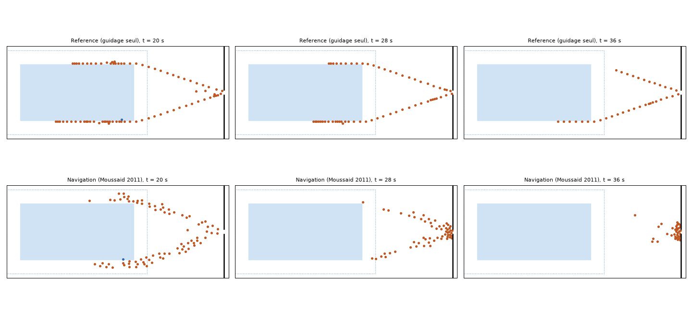

# Navigation locale des baigneurs (#158)

**Statut** : module facultatif (`navigation:` dans le YAML de la piscine et du goulot E0,
`null` par défaut). La référence n'est pas modifiée : l'activer est une décision de groupe
(#158), à prendre au vu de la validation ci-dessous.

## Le problème

Le guidage eikonal donne à tous le même plus court chemin vers la porte. Sur la plage, ce
chemin longe le bord du bassin à un rayon près, puis va en ligne droite du coin du bassin à
la porte. Comme rien n'écartait un agent de cette ligne (vitesses identiques, aucune
anticipation, régulation qui fait suivre le précédent), les baigneurs marchaient **en file
indienne contre le bord, puis en deux lignes parfaites vers la porte**. Sur dix graines,
93 % des positions de plage le long du bassin étaient à moins de 1 cm du plus près
possible, et le flux faisait 6 cm d'épaisseur.

## Le modèle : Moussaïd, Helbing et Theraulaz (2011)

*How simple rules determine pedestrian behavior and crowd disasters*, PNAS 108(17),
p. 6884-6888, vérifié sur l'original (`moussaid2011` dans la bibliographie). Deux
heuristiques fondées sur la vision :

1. **Direction.** Dans son champ de vision, de −φ à +φ autour de sa ligne de visée, le
   piéton choisit la direction α qui minimise la distance à sa destination
   `d(α)² = d_max² + f(α)² − 2 d_max f(α) cos(α₀ − α)`, où α₀ est la direction de la
   destination et f(α) la distance à la première collision s'il marchait dans la direction
   α à sa vitesse souhaitée, compte tenu de la vitesse et de la taille des autres,
   plafonnée à l'horizon d_max.
2. **Vitesse.** `v_des = min(v0, d_h / τ)`, où d_h est la distance au premier obstacle
   dans la direction choisie, à l'instant t.

La vitesse relaxe ensuite vers `v_des e_des`, comme dans tout le modèle (τ et a_max du
sol). Valeurs de l'article, reprises par défaut : τ = 0,5 s, φ = 75°, d_max = 10 m
(fig. 2), vitesse souhaitée tirée selon une loi normale de coefficient de variation
0,2/1,3 = 0,15 (fig. 3).

## Ce qui est adapté, et pourquoi

| Article | Ici | Pourquoi |
|---|---|---|
| Destination : un point | Direction du champ eikonal | La porte est derrière le coin du bassin : le champ donne la direction du plus court chemin, que l'heuristique corrige localement |
| Forces de contact k g(r_i + r_j − d_ij) | Projection du moteur | L'exclusion dure du cours reste inchangée |
| Tous les piétons | Agents sur la plage seulement | Nager n'est pas marcher ; les nageurs gardent le champ de l'eau |
| v0 ~ N(1,3 ; 0,2) m/s | Vitesse du sol × facteur individuel ~ N(1 ; 0,15), tronqué à ±3σ | Les sols et le facteur de panique gardent leur sens ; la troncature garde le déplacement par pas sous r/5 |
| — | Régulation T de Tordeux remplacée sur la plage | La seconde heuristique en est la version 2D, avec τ = 0,5 s au lieu de T = 0,35 s |
| Seconde heuristique : tous les piétons | Seuls les agents **plus avancés vers la sortie** (temps eikonal restant) | Sans cela, devant un goulot étroit, deux voisins côte à côte s'attendaient l'un l'autre, à l'arrêt, et E0 se figeait (voir la validation). L'article en sort par ses forces de contact, que la projection n'a pas : elle ne pousse pas un agent arrêté. C'est la règle d'ordre de la régulation T (`model.espacement`). Le choix de direction, lui, évite tout le monde |
| — | Marge de 1 mm face aux parois | La projection tolère 10⁻⁶ m de recouvrement ; sans marge, un agent posé contre le bassin voyait toutes ses directions bouchées |

Les obstacles vus sont les murs, le bassin, les montants de la porte (coins arrondis, comme
la projection depuis #125), les obstacles fixes et les autres agents de la plage. Une
première version à coins vifs figeait les baigneurs qui glissaient le long du coin d'un
montant, et la porte se bouchait.

## Mesure sur la piscine (17 novembre 2026)

Référence `experiments/piscine.yaml` (régulée, T = 0,35 s), graines 1 à 10, commit
`907ec49` sans modification locale, Windows. Script et bilan :
[`mesures/navigation-2026-11-17/`](mesures/navigation-2026-11-17/) (`mesurer.py`,
`resultats.json`, `sortie.txt`).

```bash
python docs/mesures/navigation-2026-11-17/mesurer.py experiments/piscine.yaml
```

| | Référence | Navigation | Navigation, Δt/2 | Navigation, sol sec | Navigation, fig. 3 (45°, 8 m) |
|---|---|---|---|---|---|
| Positions de plage contre le bord du bassin | 92,9 ± 3,3 % | **9,0 ± 1,5 %** | 8,7 % | 9,1 % | 9,0 % |
| Épaisseur du flux (écart interquartile latéral) | 0,06 m | **0,77 m** | 0,77 m | 0,76 m | 0,66 m |
| t50 (s) | 31,43 ± 0,52 | 30,68 ± 0,73 | 30,66 ± 0,79 | 30,40 ± 0,61 | 30,64 ± 0,85 |
| t90 (s) | 45,40 ± 0,76 | 43,24 ± 0,71 | 43,27 ± 1,08 | 42,59 ± 0,95 | 43,03 ± 1,08 |
| t100 (s) | 51,28 ± 1,87 | 47,17 ± 0,77 | 47,09 ± 1,13 | 46,33 ± 0,95 | 47,24 ± 1,30 |
| Débit à la porte (pers/(m·s)) | 2,28 ± 0,10 | 2,46 ± 0,07 | 2,47 ± 0,07 | 2,52 ± 0,09 | 2,46 ± 0,11 |
| Calcul par évacuation | 13 s | 31 s | 59 s | 32 s | 26 s |

Écarts appariés, graine par graine (valeur p par permutation exacte des signes) :

| | Δ t50 (s) | Δ t100 (s) | Δ débit |
|---|---|---|---|
| Navigation − référence | −0,74 ± 0,74 (p = 0,002, 10/10) | **−4,11 ± 1,67** (p = 0,002, 10/10) | +0,18 ± 0,11 (p = 0,002, 10/10) |
| Δt/2 − Δt (navigation) | −0,02 ± 0,65 (p = 0,90) | −0,07 ± 1,03 (p = 0,82) | +0,01 ± 0,08 (p = 0,83) |
| Mouillé − sec (navigation) | +0,28 ± 0,80 (p = 0,28) | +0,84 ± 1,10 (p = 0,04, 8/10) | −0,06 ± 0,08 (p = 0,04) |
| Fig. 3 − fig. 2 | −0,04 ± 0,87 (p = 0,87) | +0,08 ± 1,09 (p = 0,84) | −0,00 ± 0,08 (p = 0,88) |



*Graine 1, à 20, 28 et 36 s. En haut, la référence : deux files contre le bassin, puis deux lignes vers la porte. En bas, la navigation : des flux diffus, puis une foule devant la porte. Pointillés : limite de la bande mouillée.*

## Validation

Les heuristiques font marcher les baigneurs de façon plus naturelle ; reste à savoir si
elles donnent les bons débits et les bonnes vitesses. Deux bancs du projet le mesurent,
avec les valeurs de l'article et **sans aucun réglage**.

### Goulot E0, comparé à Seyfried et al. (2009)

`experiments/goulot.yaml`, sans régulation T (`temps_espacement: null`), avec la
navigation ; graines 1 à 10, commit `907ec49` sans modification locale. Script et bilan :
`mesures/navigation-2026-11-17/e0.py`, `e0.json`, `e0.txt`. Deux variantes : τ = 0,5 s
(l'article) et τ = 0,35 s pour la seconde heuristique, la valeur de T étalonnée pour E0.

```bash
python docs/mesures/navigation-2026-11-17/e0.py experiments/goulot.yaml
```

**Premier essai, sans la règle d'ordre** (même protocole, code non archivé) : la foule se
figeait devant les goulots étroits. À N = 40 et b = 0,8 m, 10 graines sur 10 bouchaient ;
à N = 60 et b = 0,8 ou 0,9 m, 9 sur 10. Deux voisins se voyaient l'un l'autre comme
premier obstacle et s'arrêtaient ensemble. D'où la règle d'ordre du tableau des
adaptations. Avec elle :

| N | b (m) | Écoulements (τ = 0,5) | J_s, τ = 0,5 s | Écoulements (τ = 0,35) | J_s, τ = 0,35 s | Seyfried |
|---|---|---|---|---|---|---|
| 20 | 0,8 | 10/10 | 1,29 ± 0,10 | 10/10 | 1,39 ± 0,29 | 1,86 |
| 20 | 0,9 | 10/10 | 1,28 ± 0,25 | 10/10 | 1,59 ± 0,17 | 2,06 |
| 20 | 1,0 | 10/10 | 1,51 ± 0,09 | 10/10 | 1,72 ± 0,10 | 2,19 |
| 20 | 1,1 | 10/10 | 1,49 ± 0,09 | 10/10 | 1,76 ± 0,10 | 1,78 |
| 20 | 1,2 | 10/10 | 1,56 ± 0,09 | 10/10 | 1,74 ± 0,13 | 2,31 |
| 40 | 0,8 | 9/10 | 1,24 ± 0,08 | 9/10 | 1,34 ± 0,10 | 1,77 |
| 40 | 0,9 | 10/10 | 1,23 ± 0,18 | 10/10 | 1,53 ± 0,10 | 1,91 |
| 40 | 1,0 | 10/10 | 1,46 ± 0,06 | 10/10 | 1,63 ± 0,06 | 2,08 |
| 40 | 1,1 | 10/10 | 1,51 ± 0,06 | 10/10 | 1,74 ± 0,07 | 1,93 |
| 40 | 1,2 | 10/10 | 1,48 ± 0,09 | 10/10 | 1,73 ± 0,12 | 1,81 |
| 60 | 0,8 | **4/10** | 1,30 ± 0,01 | **6/10** | 1,42 ± 0,04 | 1,61 |
| 60 | 0,9 | 10/10 | 1,28 ± 0,07 | 10/10 | 1,49 ± 0,08 | 1,86 |
| 60 | 1,0 | 10/10 | 1,42 ± 0,04 | 10/10 | 1,61 ± 0,07 | 1,90 |
| 60 | 1,1 | 10/10 | 1,45 ± 0,05 | 10/10 | 1,68 ± 0,05 | 1,93 |
| 60 | 1,2 | 10/10 | 1,48 ± 0,07 | 10/10 | 1,70 ± 0,08 | 1,97 |

J_s en pers/(m·s), estimateur de la publication, moyenne ± écart-type sur les écoulements.
Aucun recouvrement des murs au-delà de 10⁻¹⁵ m.

- **La règle d'ordre supprime presque tous les bouchages** : 288 simulations sur 300
  s'écoulent. Les 12 restantes sont toutes à b = 0,8 m, dont 10 à N = 60.
- **Avec les valeurs de l'article, le débit est de 16 à 38 % sous Seyfried.** La
  régulation T actuelle, étalonnée sur ce banc, en est à −7 à +3 % (N = 60, journal).
- **τ = 0,35 s rattrape environ la moitié de l'écart** (1 à 25 % sous Seyfried). C'est
  attendu : à jeu égal, d_h/τ autorise une vitesse 1,4 fois plus grande. Le reste n'est
  pas expliqué. Pistes non mesurées : devant l'ouverture, les agents s'écartent les uns
  des autres au lieu de se serrer ; et les plus lents, avec la dispersion des vitesses,
  imposent leur cadence dans le goulot.

### Anneau, comparé à Weidmann (1993)

Banc de #149 (couloir circulaire de 5 à 7 m, densité imposée), sans régulation T, avec la
navigation : destination le long de la tangente, murs circulaires vus par l'heuristique.
Graines 1 à 3, 40 s, vitesse mesurée de 20 à 40 s. **Code sur une branche locale**
(`exp/navigation-anneau`, commit `f186b33`, #149 + cette PR), à reverser quand #149 sera
fusionnée ; bilan : `mesures/navigation-2026-11-17/anneau.json`, `anneau.txt`.

| ρ (pers/m²) | 0,25 | 0,50 | 0,99 | 1,50 | 2,00 | 2,49 | 3,00 | 3,50 | 4,01 |
|---|---|---|---|---|---|---|---|---|---|
| v navigation (m/s) | 1,21 | 1,16 | 1,11 | 0,99 | 0,83 | 0,65 | 0,49 | 0,36 | 0,26 |
| v Weidmann | 1,34 | 1,30 | 1,06 | 0,81 | 0,61 | 0,45 | 0,33 | 0,23 | 0,16 |
| v référence T (#149, 10 graines) | 1,34 | 1,34 | 1,34 | 1,34 | 1,34 | 0,58 | 0,43 | 0,31 | 0,20 |
| J navigation (pers/(m·s)) | 0,30 | 0,59 | 1,10 | 1,49 | 1,66 | 1,61 | 1,46 | 1,26 | 1,05 |
| J Weidmann | 0,34 | 0,65 | 1,06 | 1,21 | 1,21 | 1,13 | 0,99 | 0,82 | 0,62 |

Écart-type entre graines : 0,017 m/s au plus. Dérive entre les deux moitiés de la
fenêtre : 4,3 % au plus.

- **La foule ralentit progressivement dès les faibles densités**, comme chez Weidmann. La
  référence, elle, garde v0 jusqu'à 2 pers/m², puis chute d'un coup. Le débit maximal
  passe de 2,68 (référence) à 1,66 pers/(m·s), pour 1,21 chez Weidmann.
- **Au-dessus de 1,5 pers/m², la navigation va trop vite** : de 23 % (1,5 pers/m²) à
  68 % (4 pers/m²) au-dessus de Weidmann, plus que la référence sur la branche
  congestionnée (28 à 33 %).
- **À faible densité, 10 % sous v0** (1,21 contre 1,34 m/s). Les agents longent le mur
  intérieur (63 % des positions à moins de 8 cm, graine 1), et l'heuristique leur demande
  0,92 v0 en moyenne. Cause probable, non vérifiée : sur l'anneau, la destination est la
  tangente, une droite que le mur courbe coupe. Sur une plage droite, un agent seul
  marche à v0 (`tests/test_navigation.py`).

## Ce qu'on en retient

1. **La file indienne disparaît.** Les baigneurs s'écartent du bord du bassin (9 % contre
   93 %) et le flux s'élargit d'un facteur treize. Visuellement, les deux lignes parfaites
   deviennent des flux diffus, puis une foule qui se resserre devant la porte.
2. **L'évacuation est plus rapide**, de 4 s sur t100 (10 graines sur 10), et la porte
   écoule plus : 2,46 contre 2,28 pers/(m·s). Explication possible, non mesurée : en
   utilisant la largeur de la plage, les baigneurs arrivent à la porte de front plutôt
   qu'en deux files.
3. **Ni le pas de temps ni le choix fig. 2 / fig. 3 de l'article ne changent rien de
   décelable** : moins que l'écart-type entre graines sur t50, t100 et le débit.
4. **Le sol mouillé ralentirait la fin de l'évacuation** : Δt100 = +0,84 ± 1,10 s
   (p = 0,04, 8 graines sur 10), débit −0,06 (p = 0,04), mais rien sur t50 (p = 0,28).
   Trois tests sur dix graines : une indication, à confirmer sur davantage de graines.
5. **La validation est mitigée.** La forme du ralentissement avec la densité se rapproche
   de Weidmann, ce que la référence ne fait pas. Mais au goulot, les valeurs de l'article
   donnent un débit de 16 à 38 % sous Seyfried, que la référence atteint par étalonnage.
   Activer la navigation, c'est choisir des trajectoires réalistes au prix de cet écart,
   ou régler τ sur E0 comme on a réglé T.

## Limites

- **E0 avec la navigation est sous Seyfried**, et N = 60 à b = 0,8 m bouche encore 4 à
  6 fois sur 10. Le même modèle donne 2,46 pers/(m·s) à la porte de la piscine et 1,48
  dans E0 à b = 1,2 m : la porte est une ouverture dans un mur, E0 un couloir de 2,8 m,
  et la foule n'y arrive pas de la même façon ; les deux ne se comparent pas directement.
- **Coût de calcul** : environ 2,5 fois plus long par évacuation, à cause des distances
  libres calculées dans 31 directions pour chaque baigneur de la plage.
- **Les nageurs** ne naviguent pas : dans l'eau, le guidage reste celui du champ.
- **La distance gardée au bord du bassin** n'est pas imposée. Elle vient de l'évitement des
  autres et de la dispersion des vitesses ; aucune source ne la fixe ici.
- **L'anneau** n'est mesuré que sur trois graines, et son code attend la fusion de #149.
